# Домашнее задание 1

## Задание 

### Цели задания

1. Спроектировать и нормализовать реляционную базу данных на основе набора CSV-файлов.
2. Научиться создавать таблицы в PostgreSQL с корректными ключами, типами данных и ограничениями.
3. Освоить загрузку данных из CSV в таблицы и проверку их целостности (ключи, дубли).
4. Попрактиковаться в написании SQL-запросов разной сложности: агрегации, группировки, соединения таблиц, подзапросы и оконные функции.

#### Условия

Даны CSV-файлы с данными интернет-магазина: клиенты, продукты, заказы и позиции заказов. Вам нужно спроектировать структуру базы данных, нормализовать ее, создать таблицы в DBeaver, загрузить в них данные и выполнить серию аналитических SQL-запросов.

#### Шаг 1. Создать таблицы с перечисленными ниже структурами, используя CSV-файлы

Customers

| Наименование поля | Описание |
|---|---|
| `customer_id` | Уникальный ID клиента |
| `first_name` | Имя клиента |
| `last_name` | Фамилия клиента |
| `gender` | Пол |
| `DOB` | Дата рождения |
| `job_title` | Должность/профессия |
| `job_industry_category` | Сфера деятельности |
| `wealth_segment` | Сегмент благосостояния |
| `deceased_indicator` | Признак ушедшего клиента |
| `owns_car` | Наличие автомобиля |
| `address` | Адрес проживания |
| `postcode` | Почтовый индекс |
| `state` | Штат/регион |
| `country` | Страна проживания |
| `property_valuation` | Оценка стоимости имущества |

Products

| Наименование поля | Описание |
|---|---|
| `product_id` | Уникальный ID продукта |
| `brand` | Бренд продукта |
| `product_line` | Линейка продуктов |
| `product_class` | Класс продукта |
| `product_size` | Размер/вес продукта |
| `list_price` | Рекомендованная розничная цена |
| `standard_cost` | Стандартная себестоимость |

Orders

| Наименование поля | Описание |
|---|---|
| `order_id` | Уникальный ID заказа |
| `customer_id` | ID клиента |
| `order_date` | Дата и время оформления заказа |
| `online_order` | Признак онлайн-заказа |
| `order_status` | Статус заказа |

Order Items

| Наименование поля | Описание |
|---|---|
| `order_item_id` | Уникальный ID позиции в заказе |
| `order_id` | ID заказа |
| `product_id` | ID продукта |
| `quantity` | Количество единиц продукта в заказе |
| `item_list_price_at_sale` | Цена продукта на момент продажи |
| `item_standard_cost_at_sale` | Себестоимость продукта на момент продажи |

#### Шаг 2. Анализ данных

Проверка ключей: убедиться, что у каждой таблицы определен первичный ключ.

Проверка нормализации:

- определить текущую нормальную форму каждой таблицы (1НФ, 2НФ, 3НФ);
указать, какие атрибуты нарушают нормализацию (повторяющиеся группы, транзитивные зависимости и т. п.);
при необходимости — предложить декомпозицию схемы.

Проверка дублей по ключам:

- посчитать количество строк и количество уникальных значений ключа;
если дубли есть — удалить их любым способом;
после удаления — назначить PRIMARY KEY / UNIQUE на соответствующие столбцы.

Отчет по шагу. Должен содержать таблицу с результатами: имя таблицы, есть ли PK/FK, выявленные дубли, примененный способ дедубликации, итоговое количество строк.

#### Шаг 3. Выполнить запросы

Выполните следующие действия:

1. Выведите id продукта и среднюю цену продажи (item_list_price_at_sale) для 5 продуктов с самой высокой средней ценой продажи.
2. Рассчитайте общую стоимость заказа (item_list_price_at_sale * quantity) для каждого бренда продукта.
3. Подсчитайте количество заказов за каждый месяц для каждого года. То есть необходимо вывести год, месяц и количество заказов.
4. Для каждой продуктовой линейки (product_line) найдите продукт с самой высокой стандартной стоимостью (standard_cost). Выведите id продукта, линейку продукта и стандартную стоимость.
5. Подсчитайте количество заказов и общую стоимость заказов для каждого статуса заказа (order_status). Общую стоимость заказа необходимо рассчитать как цену продукта на момент продажи, умноженную на количество единиц продукта в заказе.
6. Найдите клиентов, у которых нет ни одного заказа. Выведите id клиента, фамилию и имя.
7. Для каждого штата найдите клиента с самой высокой и самой низкой оценкой стоимости имущества (property_valuation). Выведите штат, оценку стоимости имущества, фамилию и имя клиента.
8. Найдите клиентов, которые покупали продукты только из одной продуктовой линейки (product_line). Выведите id клиента, линейку продукта и количество заказов.
9. Для каждой категории продуктов рассчитайте процент отмененных заказов (order_status = 'Cancelled').
10. Разделите клиентов на сегменты на основе количества заказов и подсчитайте количество клиентов в каждом сегменте:
        сегмент High, если количество заказов больше 10;
        сегмент Medium, если количество заказов от 5 до 10;
        иначе сегмент Low.
11. Для всех клиентов выведите имена, фамилии, профессии, а также длительность максимального интервала (в днях) между двумя последовательными заказами. Необходимо исключить клиентов, у которых только один заказ или меньше.

## Выполнение

### Шаг 1

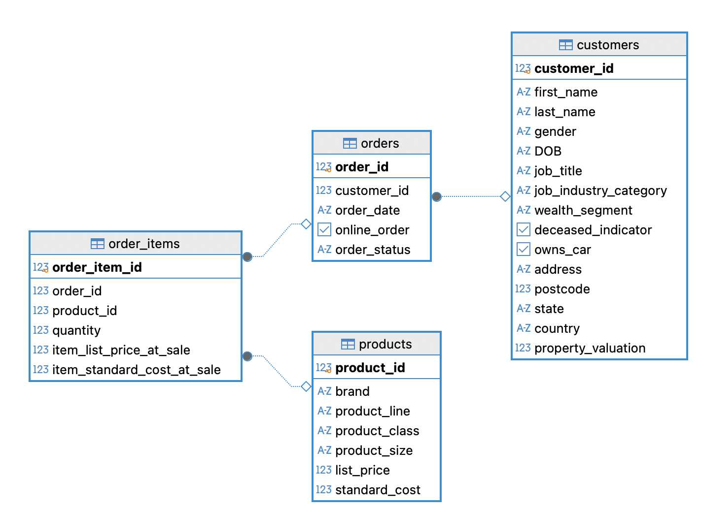

### Шаг 2

При загрузке таблиц из csv, я отдельно указал какие столбцы являются первичными и внешними ключами. Ошибок наличия повторяющихся ключей не было - дедупликация не требовалась. Результат отражен в шаге выше. 

|Название таблицы|Количество записей|Первичный ключ|Внешние ключи|Нормализация|
|---|---|---|---|---|
|`customers`|5000|`customer_id`|-|3НФ(2НФ если `state` однозначно определяет страну `customer_id -> state -> country`)|
|`orders`|25000|`order_id`|`customer_id`|3НФ(атрибуты атомарны, зависимости между атрибутами нет)|
|`order_items`|50000|`order_item_id`|`order_id`, `product_id`|3НФ(атрибуты атомарны, зависимости между атрибутами нет)|
|`products`|300|`product_id`|-|3НФ(атрибуты атомарны, зависимости между атрибутами нет)|

Предложений по нормализации нет, схема выглядит работоспособной.

### Шаг 3

[Посмотреть sql](КиршЯА_HW_01.sql)

1. 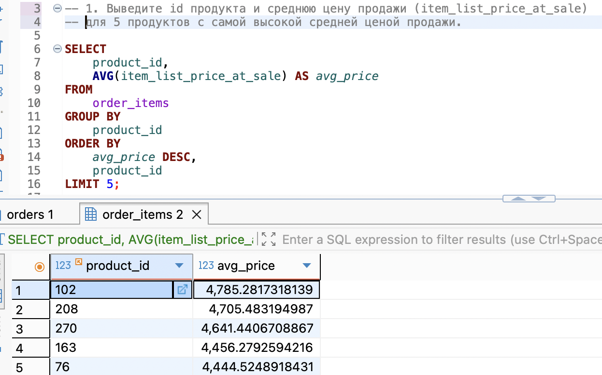
2. 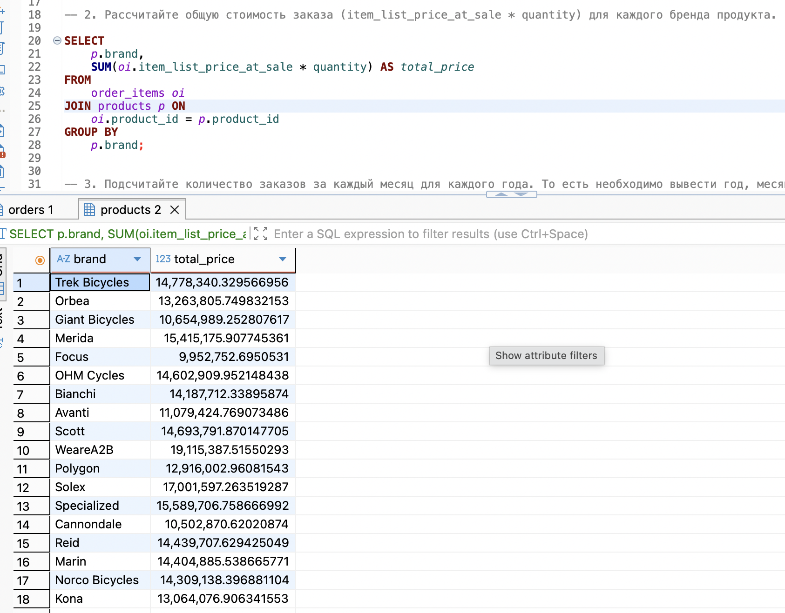
3. 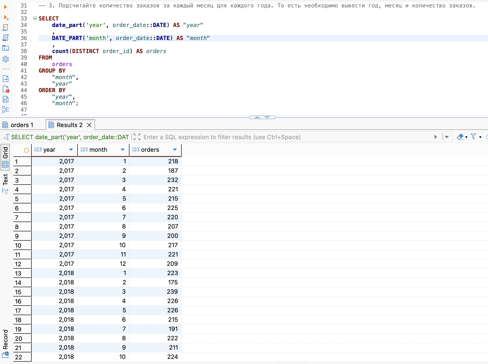
4. 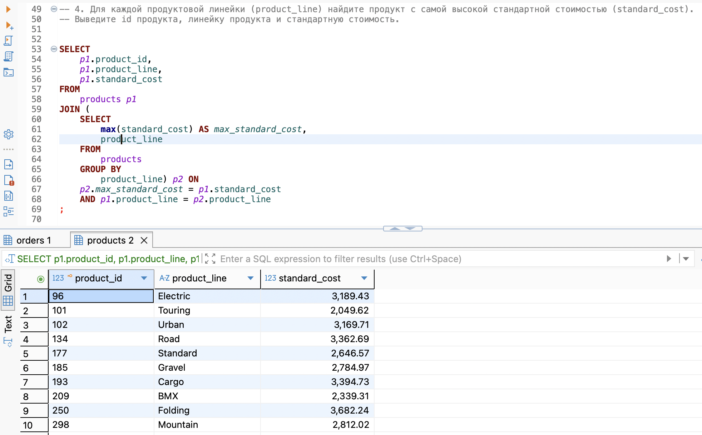
5. 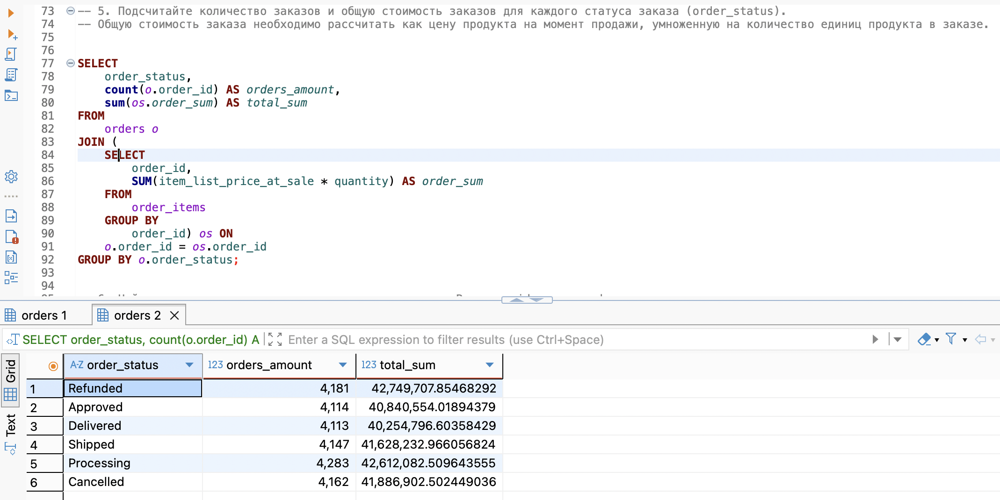
6. 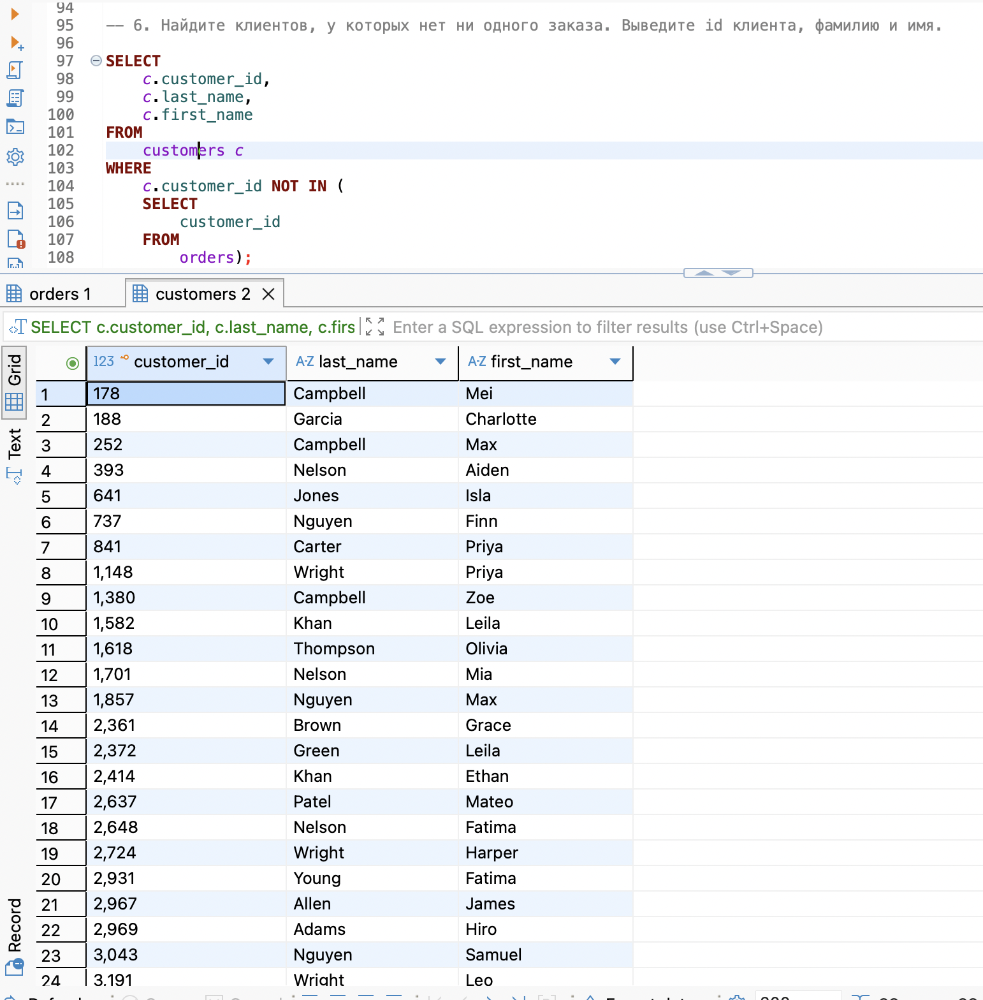
7. 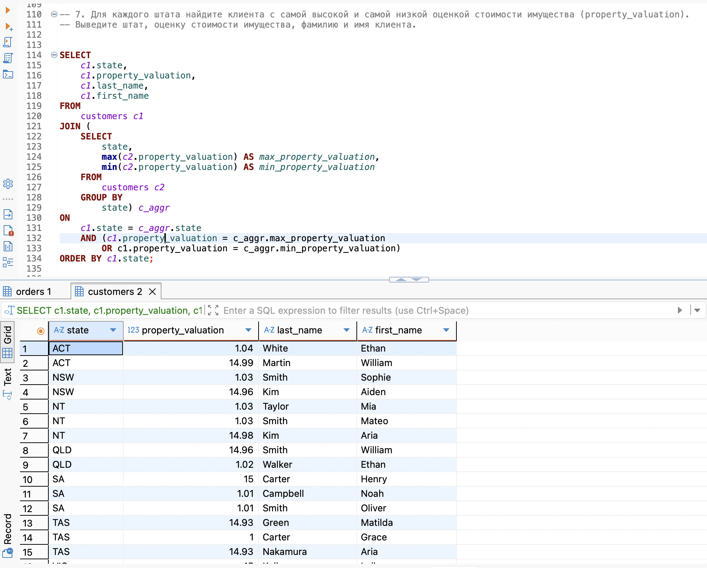
8. 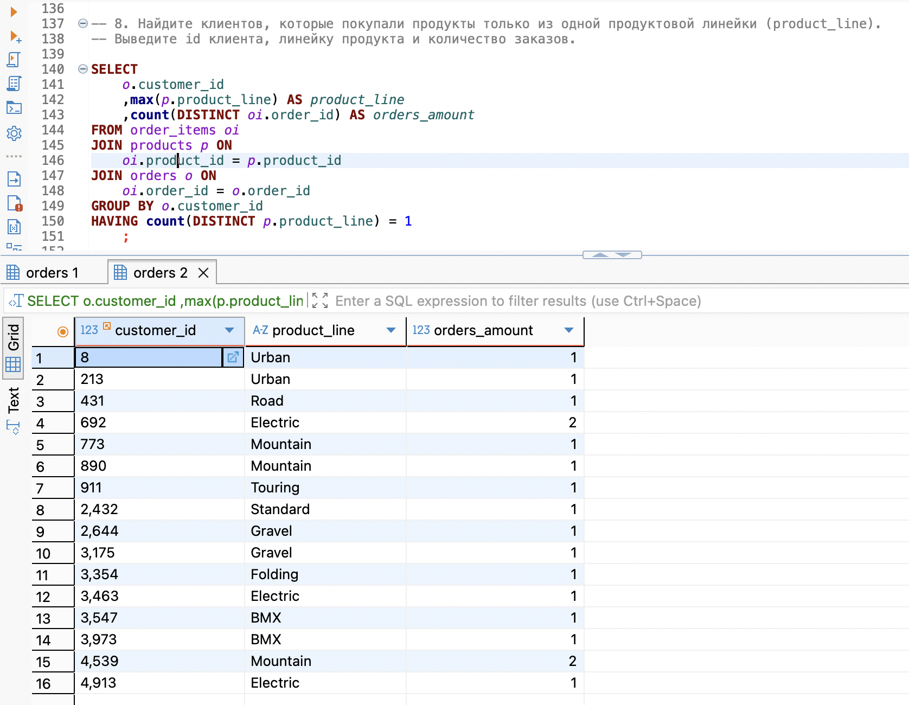
9. 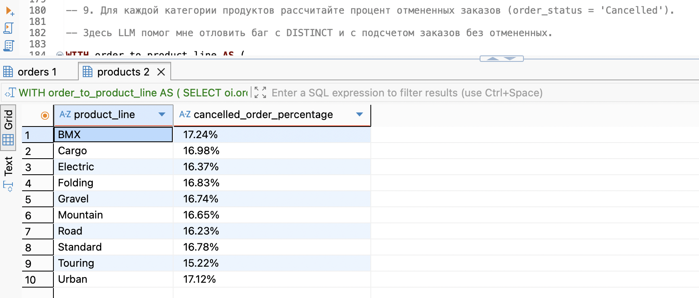
10. 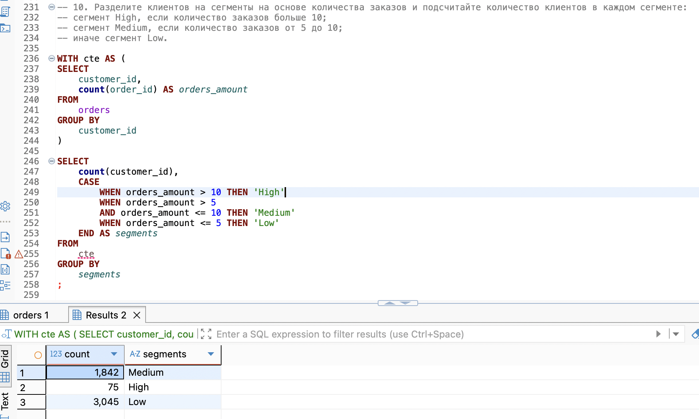
11. 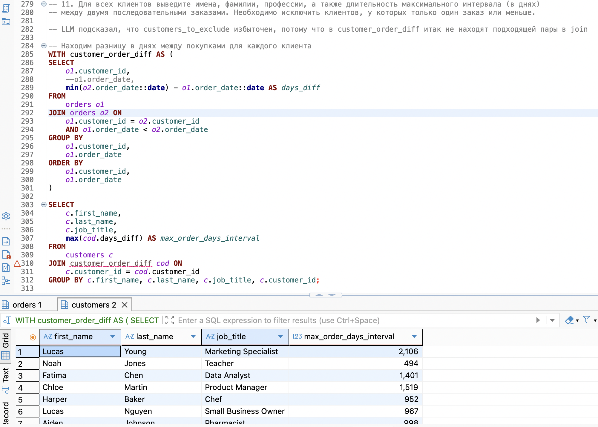
